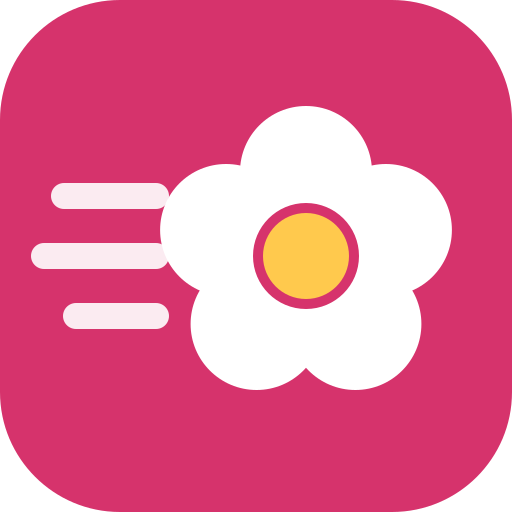

# FlorLovesRunning



App móvil privada (PWA instalable) para **Sofi y Flor**: carreras, comidas, recetas y sueño, con datos en **Supabase**, acceso con **Google** o **Strava**, importación automática de carreras de **Garmin** (vía Strava) y cálculo de macros con **IA**.

## Qué hace

- **Correr**: km, tiempo y tipo. Ritmo por km, km semanales frente al objetivo, ritmo medio del mes y gráfico de 7 días. Las carreras de Strava llegan solas, con desnivel y pulso medio.
- **Comidas**: macros a mano, desde una receta o estimados por IA a partir de una descripción («2 huevos y una tostada con aguacate»).
- **Recetas**: ingredientes con cantidades; la IA calcula los macros totales y por porción. **Las recetas son compartidas** entre Sofi y Flor.
- **Cuerpo**: peso, grasa corporal (%) e **IMC** calculado con tu altura (categorías de la OMS), con gráficos de 90 días, cambio en 30 días y distancia al peso objetivo. Incluye la pestaña de **Sueño**: horas, calidad, media de 7 días y déficit.
- **Resumen**: todo consolidado por periodo (4 semanas, 3 meses, 12 meses o todo el historial): km, ritmo medio, calorías y proteína medias por día, sueño medio, peso, IMC y grasa con su variación; gráficos de km por semana o mes, peso, grasa, calorías y sueño frente a tus objetivos; **récords** (carrera más larga, mejor ritmo en 5 km o más, mejor semana y mejor mes) y una tabla **mes a mes**.
- **Ajustes**: objetivos (incluido peso objetivo y altura), conexión con Strava, exportar/importar copia, borrar registros y cerrar sesión.

Pestañas: Hoy · Correr · Comidas (Diario / Recetas) · Cuerpo (Peso y grasa / Sueño) · Resumen.

Carreras, comidas, sueño, mediciones y objetivos son **privados** de cada una (políticas RLS en Supabase).

## Cómo funciona

| Pieza | Dónde |
|---|---|
| App (HTML/CSS/JS sin framework) | raíz: `index.html`, `css/`, `js/`, `icons/` |
| Base de datos, login y seguridad | Supabase — esquema en `supabase/schema.sql` |
| IA de macros (Claude) | `netlify/functions/macros.mjs` → `POST /api/macros` |
| Strava: login, conexión y sincronización | `netlify/functions/strava-*.mjs` → `/api/strava/*` |
| Build (cliente de Supabase + configuración pública) | `scripts/build.mjs` (`npm run build`) |

- Solo los dos emails de la tabla `allowed_emails` pueden crear cuenta: lo impide un trigger en la base de datos, no solo la app.
- **Strava como login**: Strava no da el email, así que la primera vez se entra con Google y se conecta Strava en Ajustes; desde entonces el botón «Continuar con Strava» abre la sesión de esa cuenta.
- **Garmin**: el reloj sincroniza con Garmin Connect, Garmin Connect envía cada actividad a Strava, y FlorLovesRunning importa las carreras nuevas al abrirla (cada 3 h) o con «Sincronizar».
- Las claves secretas (service role de Supabase, Strava, Anthropic) solo existen en las funciones de Netlify.

## Puesta en marcha (una sola vez)

### 1. Supabase

1. Crea un proyecto en <https://supabase.com>.
2. Abre `supabase/schema.sql`, **cambia los dos emails** (`sofi@example.com`, `flor@example.com`) por los Gmail reales de Sofi y Flor, y ejecútalo en **SQL Editor → New query → Run**.
3. Si ya lo habías ejecutado antes, **vuelve a ejecutarlo** tras cada actualización de la app: es idempotente y añade lo nuevo (por ejemplo, la tabla de peso) sin borrar datos.
4. En **Project Settings → API** copia: *Project URL*, la clave pública (*anon* o *publishable*) y la *service_role* (o *secret*).

### 2. Google (inicio de sesión con Gmail)

1. En <https://console.cloud.google.com> → *APIs y servicios → Credenciales* → **Crear ID de cliente OAuth** (tipo *Aplicación web*).
2. *URI de redireccionamiento autorizados*: `https://<tu-proyecto>.supabase.co/auth/v1/callback` (aparece en Supabase al activar Google).
3. En la *pantalla de consentimiento* añade los emails de Sofi y Flor como usuarias de prueba (o publícala).
4. En Supabase → **Authentication → Sign In / Providers → Google**: actívalo y pega el *Client ID* y el *Client secret*.
5. En Supabase → **Authentication → URL Configuration**:
   - *Site URL*: `https://<tu-sitio>.netlify.app/`
   - *Redirect URLs*: `https://<tu-sitio>.netlify.app/`
6. Deja activado el proveedor **Email** (lo usa el acceso con Strava por dentro; no se envían correos).

### 3. Strava

1. En <https://www.strava.com/settings/api> crea una aplicación.
2. *Authorization Callback Domain*: `<tu-sitio>.netlify.app` (solo el dominio).
3. Copia *Client ID* y *Client Secret*.
4. Sofi y Flor: en **Garmin Connect → Ajustes → Aplicaciones conectadas → Strava**, activad la sincronización.

> Una app nueva de Strava admite pocas atletas conectadas; para dos personas sobra.

### 4. Netlify

1. **Add new site → Import an existing project → GitHub** y elige este repositorio. Netlify lee `netlify.toml` (build `npm run build`, publica la raíz).
2. **Site configuration → Environment variables**:

| Variable | Valor |
|---|---|
| `SUPABASE_URL` | Project URL de Supabase |
| `SUPABASE_ANON_KEY` | clave pública (*anon* / *publishable*) |
| `SUPABASE_SERVICE_ROLE_KEY` | clave *service_role* / *secret* (marca *Functions* como único alcance si puedes) |
| `STRAVA_CLIENT_ID` | de Strava |
| `STRAVA_CLIENT_SECRET` | de Strava |
| `STATE_SECRET` | una cadena aleatoria larga (p. ej. `openssl rand -hex 32`) |
| `ANTHROPIC_API_KEY` | de <https://platform.claude.com> (para la IA de macros) |

3. **Deploys → Trigger deploy**. Abre `https://<tu-sitio>.netlify.app/`, entra con Google y conecta Strava en Ajustes.
4. En el móvil: menú del navegador → **Añadir a pantalla de inicio**.

Cada `git push` a la rama conectada vuelve a desplegar.

### Pasar los datos de la versión de prueba

Si usaste la vista previa: **Ajustes → Exportar** allí, y **Ajustes → Importar** en la app desplegada.

## Diseño UX/UI

- Tipografía **Inter**: diseñada para pantallas, muy legible en tamaños pequeños, con **cifras tabulares** para que los números se alineen y no «bailen».
- Escala tipográfica 1.25 sobre base 16 px (evita el zoom de iOS en los campos), rejilla de 8 px y objetivos táctiles ≥ 44 px.
- Tema claro y oscuro automáticos con contraste WCAG AA; color con significado constante (naranja = correr, violeta = sueño, un color por macro).
- Pestañas abajo (alcance del pulgar), formularios en hojas inferiores, teclado numérico, coma decimal y cálculos en vivo.
- Accesible: etiquetas en todos los campos, foco visible, `aria-current`, roles ARIA en barras de progreso y `prefers-reduced-motion`.

## Desarrollo local

```bash
npm install
npx netlify dev        # con las variables de entorno de arriba en un .env
# abre http://localhost:8888/
```
